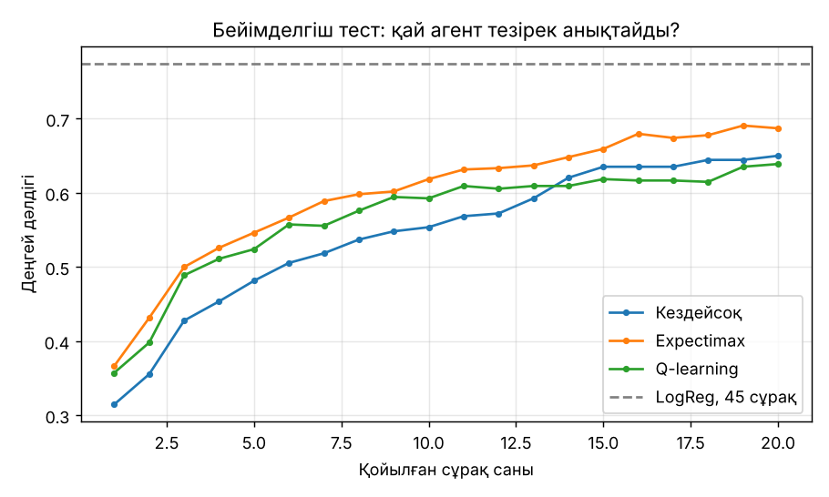
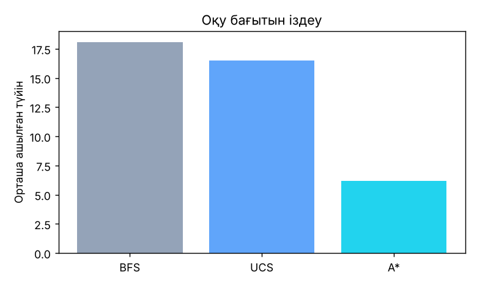
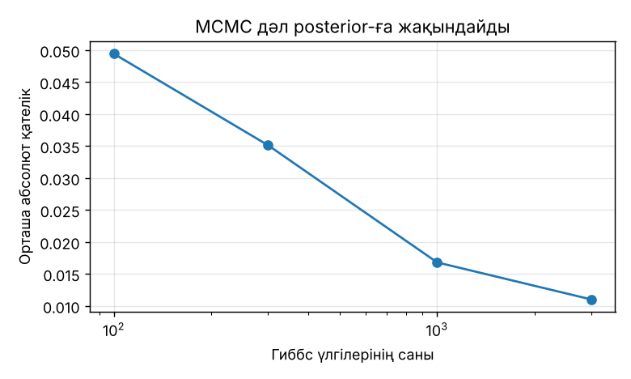

# Нәтижелер

## 1. Деңгейді анықтау дәлдігі (60 тест студенті × 9 тақырып)

| Модель                                             | Деңгей дәлдігі   | Әлсіз тақырыпты табу (recall)   |   Орташа сұрақ саны |
|:---------------------------------------------------|:-----------------|:--------------------------------|--------------------:|
| LogReg, толық тест (45 сұрақ)                      | 77.4%            | 92.2%                           |                45   |
| Байес желісі, толық тест (45 сұрақ)                | 73.1%            | 97.7%                           |                45   |
| Байес желісі, бейімделгіш тест (кездейсоқ агент)   | 65.0%            | 82.9%                           |                19.8 |
| Байес желісі, бейімделгіш тест (expectimax агенті) | 66.9%            | 97.1%                           |                15.4 |
| Байес желісі, бейімделгіш тест (Q-learning агенті) | 63.9%            | 89.4%                           |                20   |

## 2. Сұрақ саны → дәлдік

|          | Кездейсоқ   | Expectimax   | Q-learning   |
|:---------|:------------|:-------------|:-------------|
| 5 сұрақ  | 48.1%       | 54.6%        | 52.4%        |
| 10 сұрақ | 55.4%       | 61.9%        | 59.3%        |
| 15 сұрақ | 63.5%       | 65.9%        | 61.9%        |
| 20 сұрақ | 65.0%       | 68.7%        | 63.9%        |

## 3. Оқу бағыты: BFS / UCS / A*

| Әдіс                               |   Орташа ашылған түйін |   Орташа құн |
|:-----------------------------------|-----------------------:|-------------:|
| BFS                                |                   18.1 |        271   |
| UCS                                |                   16.5 |        264.6 |
| A*                                 |                    6.2 |        264.6 |
| Тек тереңдік бойынша (ICT нұсқасы) |                   —   |        266.5 |

A* бағыты тереңдік бойынша сұрыптаудан 72% жағдайда арзанырақ, орташа үнем 0.9%. UCS пен A* құны бірдей (екеуі де оңтайлы), бірақ A* түйінді аз ашады.

## 4. Жасыту әдісі (simulated annealing) vs толық перебор

174 жағдай (студент × уақыт шегі [8, 15, 25] сағ): SA оңтайлы шешімді 100% жағдайда тапты, орташа айырма 0.00%.

## 5. Гиббс сэмплингі (MCMC) vs дәл есептеу (enumeration)

|   Үлгі саны |   Орташа қателік |
|------------:|-----------------:|
|         100 |            0.049 |
|         300 |            0.035 |
|        1000 |            0.017 |
|        3000 |            0.011 |

